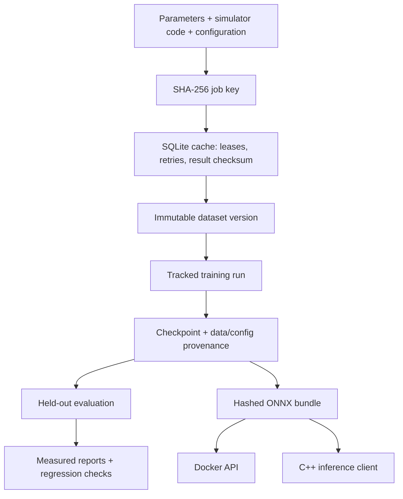

# Reproducible Simulation & ML Platform

**Data, training, evaluation and deployment — one auditable, standalone project.**

A local-first Python platform for running mechanical-signal simulations, assembling immutable datasets, training a PyTorch surrogate and serving the same model through ONNX Runtime, a Dockerized HTTP API and a compiled C++ client.

The reference application predicts RMS displacement, velocity and acceleration of a forced damped oscillator from five physical parameters. The simulator includes its initial transient.

## Included evidence

| Check | Reference result |
|---|---|
| Simulated dataset | 3,200 designs in 80 families; family-separated splits |
| Held-out evaluation | 480 examples, never used for fitting or checkpoint selection |
| Model R² | 0.976 / 0.971 / 0.987 for displacement / velocity / acceleration |
| Relative MAE | 5.85% / 3.76% / 2.62%, normalized by each target's test-set mean |
| Cache reuse | 3,200 hits; **zero simulator executions** on the second pass |
| Data assembly, cold / warm | 6.81 s / 0.66 s on the recorded host |
| Numerical parity | PyTorch ↔ ONNX Python ↔ ONNX C++, batches 1, 7, 64, 256 |
| API | Health, prediction, schema/batch validation, verified artifact loading |

Raw results, timings, tolerances, environment details and artifact IDs are committed in [reports](reports/). Reference data, trained weights and the ONNX bundle are included in [artifacts](artifacts/). Wall-clock timings are measurements on one CPU environment, not portable performance promises.

## Quick start

Python 3.10+ for the package; the tested serving environment is Python 3.12 on Linux x86_64.

```bash
python -m venv .venv
source .venv/bin/activate  # Windows: .venv\Scripts\activate
python -m pip install torch --index-url https://download.pytorch.org/whl/cpu
python -m pip install -r requirements/api.lock
python -m pip install -e '.[train,serve,dev]'
```

Run the included model without retraining:

```bash
SIMML_BUNDLE=artifacts/bundle python -m uvicorn simml.api:app --host 127.0.0.1 --port 8000
```

In another terminal:

```bash
curl http://127.0.0.1:8000/health
curl -X POST http://127.0.0.1:8000/predict \
  -H 'Content-Type: application/json' \
  -d '{"parameters":[{"natural_frequency_hz":7,"damping_ratio":0.12,"drive_frequency_hz":8,"force_n":1,"mass_kg":1}]}'
```

Open `/docs` for the generated OpenAPI interface. The service returns three nonnegative RMS predictions and the exact bundle ID. The network only predicts; it does not execute simulation jobs.

## Docker

```bash
docker build -t simml-api:local .
docker run --rm --read-only --tmpfs /tmp:rw,size=64m \
  -p 127.0.0.1:8000:8000 simml-api:local
python scripts/container_smoke.py
```

The runtime image contains ONNX Runtime and the serving code. It **does not install PyTorch** or copy training data/checkpoints. It runs as UID 10001 and verifies ONNX hashes/lineage at startup. Dependencies are pinned in [requirements/api.lock](requirements/api.lock). The base image is a version tag, not a digest, so rebuilding it is not claimed to be bit-identical.

## Build and test C++

Linux x86_64, a C++17 compiler and CMake 3.20+:

```bash
python scripts/fetch_ort.py
cmake -S cpp -B build/cpp -DONNXRUNTIME_ROOT="$PWD/build/ort" -DCMAKE_BUILD_TYPE=Release
cmake --build build/cpp -j 2
SIMML_CPP_BINARY="$PWD/build/cpp/simml_predict" python -m pytest -q
python scripts/check_reference.py
```

`fetch_ort.py` obtains headers from Microsoft's **v1.24.4** tag and uses the matching official Python wheel's shared library; it records downloaded dependency hashes in `build/ort/dependencies.json`. Build dependencies are not vendored.

The C++ client accepts `model.onnx input.txt output.txt`. Input is the batch size followed by rows of five whitespace-separated physical parameters, in the table's order below. Output contains three physical predictions per row. It validates input dimensions, bounds, finite values and ONNX tensor names/types. It is a reference client; artifact hash verification belongs to the Python bundle loader and deployment packaging, not this small C++ executable.

## Reproduce data → training → evaluation → export

```bash
python scripts/reproduce.py --cpp-binary build/cpp/simml_predict
```

The fixed configuration is [configs/reference.json](configs/reference.json). Intermediate job state, immutable dataset versions and tracked experiments live under `work/`. Repeating dataset assembly reuses completed jobs. The script exports the selected data/model/bundle to `artifacts/` and writes measured evidence to `reports/`.

For an isolated rerun that preserves the checked-in reference artifacts:

```bash
python scripts/reproduce.py --work work/rerun --output work/rerun-evidence \
  --cpp-binary build/cpp/simml_predict
```

Independent commands:

```bash
simml dataset --families 80 --members 40
simml train --dataset work/datasets/<dataset-id> --epochs 250
simml evaluate --dataset work/datasets/<dataset-id> --checkpoint work/runs/<train-run>/checkpoint.pt
simml export --checkpoint work/runs/<train-run>/checkpoint.pt --output work/bundle
simml runs --root work/runs
```

Random seeds fix sampling and model training; run IDs and timestamps intentionally vary. Artifact IDs are content hashes, so byte hashes may differ if metadata, dependency versions, source code or serialization changes. Numerical reproducibility is checked separately from byte identity.

## Traceability and recovery



- **Job identity:** canonical JSON with sorted keys and normalized numeric parameters, simulation settings, simulator-source hash, contract version and NumPy version. Different parameters or simulation configurations cannot reuse one another's results.
- **Recovery:** SQLite transactions claim jobs with a lease and owner token. Failed jobs can retry up to three attempts. Expired leases can be reclaimed; a previous owner's late result is rejected. Completed results carry their own checksum.
- **Data versions:** dataset IDs cover logical array content, sampling configuration and simulator identity. A compressed-file checksum also catches byte-level corruption. Existing versions are verified instead of overwritten.
- **Experiment records:** every training/evaluation run has a config hash, inputs, status, event stream and artifact checksums. Failed contexts record errors. Checkpoints embed the complete data manifest plus training/evaluation configs and their hashes; a sidecar protects the checkpoint bytes.
- **Portable inference:** input normalization and output inverse transformation are inside the exported graph. Model metadata links ONNX back to its checkpoint and dataset. Both the service and numerical-parity checks operate on physical inputs/outputs.

## Simulator contract

The example is an underdamped driven single-degree-of-freedom oscillator, initially at rest:

\[
m\ddot{x} + 2\zeta m\omega_n\dot{x} + m\omega_n^2x = F\sin(2\pi f_dt),\quad\omega_n=2\pi f_n.
\]

| Input order | Name | Unit | Valid range |
|---|---|---|---|
| 1 | `natural_frequency_hz` | Hz | 2–15 |
| 2 | `damping_ratio` | dimensionless | 0.03–0.30 |
| 3 | `drive_frequency_hz` | Hz | 1–20 |
| 4 | `force_n` | N | 0.2–3 |
| 5 | `mass_kg` | kg | 0.5–3 |

Reference sampling: 256 Hz for 4 seconds. Outputs are `displacement_rms_mm`, `velocity_rms_mm_s`, and `acceleration_rms_mm_s2`. The analytic signal is checked against an independent RK4 integrator, initial-rest conditions, force scaling and inverse-mass scaling. Reference cases freeze the numerical behavior.

## Verification and limits

The workflow checks simulator contracts, immutable data versions, family isolation, cache reuse, failed/expired jobs, concurrent-owner fencing, artifact/config tampering, held-out metrics, ONNX/C++ numerical parity, model regression and HTTP validation. The included GitHub Actions workflow is configured to build the Docker image and exercise it through actual HTTP. The image build awaits its first CI run; Docker is unavailable in the local build environment. The API itself has passed real HTTP checks locally.

This is a **single-host reference platform**, not a distributed scheduler or a production service. SQLite's default 60-second lease has no heartbeat: it suits the millisecond simulator here, and must be extended or redesigned for long-running jobs. Retries do not guarantee exactly-once computation; owner fencing prevents stale result publication. Local file hashes detect accidental mismatch, not malicious replacement of both payload and manifest. No GPU, cloud infrastructure, authentication, autoscaling or physical measurement validation is claimed.

The surrogate approximates the numerical simulator within the sampled parameter domain. Near resonance, a low average error can hide individual large errors; inspect the held-out report before using it for engineering decisions. See [failure cases](docs/failure-cases.md) and [benchmark protocol](docs/benchmarks.md).

MIT license · Amer Saidi.
